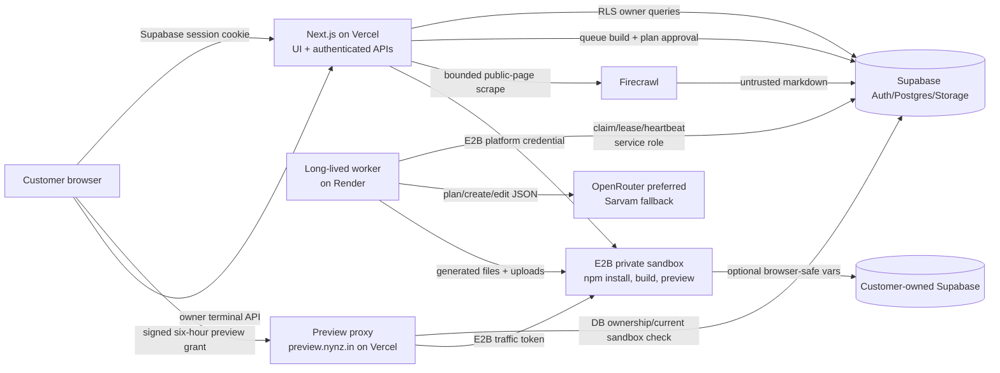

# NYNZ current-state audit

**Audit date:** 4 November 2026 (Asia/Kolkata)  
**Scope:** `/Users/adibsattar/Desktop/NYNZ.IN`, GitHub repository `jigriwork/nynz-builder`, the configured Supabase project, public Vercel endpoints, and the observable Render worker  
**Method:** source and configuration review, read-only production-state queries, local automated checks, and disposable-user browser checks. No feature code was changed, no deployment was made, and no paid generation was run.

## A. Executive assessment

NYNZ is a functioning private-beta AI web-application builder, not yet an operable paid SaaS business. A signed-in customer can describe a React web app, review and revise an AI-produced plan, approve generation, watch a durable worker generate source, compile it in an isolated E2B sandbox, use a separately authorised live preview, request focused edits, inspect/edit files, run terminal commands, save/restore checkpoints, upload assets, import one public web page, connect a customer-owned Supabase client key, and export source as ZIP.

The core create/edit architecture is real and has substantial live evidence. The current production database contains successful OpenRouter/Sarvam builds and an active Render worker heartbeat. Safe checks performed during this audit all passed. However, this audit did not spend money on a new generated app because the requested combined ₹50 ceiling cannot be enforced: the configured code guard is ₹75 per build and checks cost only after a provider response.

NYNZ is **not ready for a paid public launch**. The principal blockers are:

1. **No billing system:** no products, subscriptions, checkout, tax/GST handling, webhooks, entitlement ledger, credit wallet, invoices, renewals, cancellations, or customer plan records exist.
2. **No real owner/superadmin:** the schema has only `member` and `admin`; the connected production database has one member and zero admins. The admin page is a narrow health view, not an operations console.
3. **A critical resource-identifier boundary:** project owners may update platform-managed `projects` columns through Supabase RLS, including `active_sandbox_id`. Terminal and preview code trust that value while using NYNZ's E2B credential. A user who learns another sandbox ID could potentially point their project at it and obtain preview/command access. This was inferred from code and was not exploited.
4. **Accounting is incomplete:** “credits” are derived model tokens, not an allowance or wallet. OpenRouter provider-reported model cost is partly measured, while Sarvam failures/retries, failed or idle E2B use, Firecrawl failures, hosting, database, domains, monitoring, and other shared expenses are not accounted for.
5. **No production publishing:** E2B provides private, pausable previews. There is no durable customer hosting, deployment, custom domain, update, unpublish, or generated-app lifecycle.
6. **Recovery and cleanup gaps:** source/checkpoint writes are not transactional, failed generation can leave partial source, restore deletes then reinserts files without a transaction, and project deletion/restore do not terminate sandboxes or remove storage objects.
7. **Product claims exceed support in places:** “production-ready” and “every version can be restored” are too broad; generated apps are React/TypeScript/Vite only, backend setup remains manual, there is no publishing, and restore is non-atomic.

Recommended disposition: operate only as a tightly controlled private beta with manual oversight until the P0 items in section I are complete.

## B. What was audited

### Repository and working state

| Item | Confirmed state | Evidence |
|---|---|---|
| Workspace | `/Users/adibsattar/Desktop/NYNZ.IN` | `pwd` during audit |
| Repository | `https://github.com/jigriwork/nynz-builder.git` | Git remote `origin` |
| Upstream | `https://github.com/firecrawl/open-lovable.git` | Git remote `upstream`; [docs/UPSTREAM.md](UPSTREAM.md) |
| Branch | `feat/nynz-platform` | `git branch --show-current` |
| Commit | `e24612b9c7d4267525e8e263c9f5a9cd71501cc8` | `git rev-parse HEAD` |
| Remote match | `origin/feat/nynz-platform` resolved to the same commit on 4 Nov 2026 | `git ls-remote origin refs/heads/feat/nynz-platform` |
| Worktree | Clean before this report; this report is the only audit-created file | `git status --porcelain=v2` before writing |
| Governing instructions | No `AGENTS.md` exists in the repository | `rg --files -g AGENTS.md` |

The public site was reachable at `https://www.nynz.in` through Vercel; `https://nynz.in` redirected there. `https://preview.nynz.in` was also on Vercel and returned HTTP 401 without preview authorisation. The local Vercel link names project `nynz-platform-preview`; a separate tracked `preview-host` package implements the preview proxy. Browser tests against `www.nynz.in` matched current selectors and current rename/plan/settings behaviour, but no accessible deployment metadata proved the exact deployed Git SHA. Therefore behavioural parity is confirmed for the tested surfaces; byte-for-byte/local-commit parity is unverified.

The background worker is configured in [render.yaml](../render.yaml#L1) for Render Singapore, Starter plan, branch `feat/nynz-platform`, with auto-deploy. The production `worker_heartbeats` record reported `render-worker-1` idle and current at audit time. This proves a worker using the current heartbeat protocol is live, but it does not independently prove its exact deployed SHA.

### Technology and active services

| Layer/service | Actual responsibility | Status/evidence |
|---|---|---|
| Next.js 15.5 / React 19 / TypeScript 5 | Marketing site, authentication UI, dashboard, builder, authenticated API routes | [package.json](../package.json); build passed |
| Tailwind CSS / Framer Motion / Radix | Product styling, motion and UI primitives | [package.json](../package.json) |
| Supabase Auth | Email/password registration, email verification according to project auth settings, sessions | [app/login/page.tsx](../app/login/page.tsx#L23) |
| Supabase Postgres + RLS | Projects, files, conversations, messages, versions, jobs, imports, usage, backend connections, worker state | [20261031000100_nynz_core.sql](../supabase/migrations/20261031000100_nynz_core.sql#L7) |
| Supabase Storage | Private project asset bucket | [20261031000100_nynz_core.sql](../supabase/migrations/20261031000100_nynz_core.sql#L116) |
| OpenRouter | Preferred planner/create/edit provider whenever `OPENROUTER_API_KEY` exists | [lib/platform/generation.ts](../lib/platform/generation.ts#L6), [lib/platform/openrouter.ts](../lib/platform/openrouter.ts#L66) |
| Sarvam | Code-level fallback generator when OpenRouter is not configured, but not a viable end-to-end fallback because the mandatory approval plan calls OpenRouter directly | [lib/platform/generation.ts](../lib/platform/generation.ts#L6), [scripts/worker.ts](../scripts/worker.ts#L52), [lib/platform/sarvam.ts](../lib/platform/sarvam.ts#L213) |
| Firecrawl | Server-side import of one public page as untrusted reference markdown | [app/api/projects/[id]/import/route.ts](../app/api/projects/[id]/import/route.ts#L10) |
| E2B | Isolated file writes, dependency installation, production compilation, private preview runtime and customer terminal | [lib/platform/e2b.ts](../lib/platform/e2b.ts#L46) |
| Render | Long-lived durable build worker | [render.yaml](../render.yaml#L1), live heartbeat |
| Vercel | Public Next.js website and separate preview proxy | HTTP/DNS observation; [preview-host/vercel.json](../preview-host/vercel.json#L1) |
| Customer Supabase | Optional customer-owned generated-app database/auth/storage endpoint; NYNZ stores URL + browser-safe key only | [backend route](../app/api/projects/[id]/backend/route.ts#L6) |

Several AI SDKs and older sandbox/provider implementations remain in dependencies/source, but middleware rejects every `/api/*` endpoint except `/api/projects`, `/api/builds`, and `/api/admin` with HTTP 410 after authentication. They are not part of the current product path ([middleware.ts](../middleware.ts#L20)). Their presence increases maintenance and dependency surface.

### Configuration inventory (names only)

Local `.env.local` had configured values for `SARVAM_API_KEY`, `FIRECRAWL_API_KEY`, `E2B_API_KEY`, `NEXT_PUBLIC_SUPABASE_URL`, `NEXT_PUBLIC_SUPABASE_PUBLISHABLE_KEY`, `SUPABASE_SERVICE_ROLE_KEY`, `SARVAM_MODEL`, `SARVAM_BASE_URL`, `E2B_SANDBOX_TIMEOUT_MS`, and `VERCEL_OIDC_TOKEN`. It did **not** have `OPENROUTER_API_KEY`. Values were not printed.

Tracked [`.env.example`](../.env.example) additionally defines the operational knobs `E2B_TEMPLATE`, `E2B_PREVIEW_ACTIVE_SECONDS`, `FIRECRAWL_MAX_PAGES`, `GENERATION_MAX_OUTPUT_TOKENS`, `GENERATION_MAX_REPAIRS`, `OPENROUTER_*`, `USD_TO_INR_RATE`, `DAILY_*`, `NEXT_PUBLIC_APP_URL`, `PREVIEW_ORIGIN`, `PREVIEW_GATEWAY_PORT`, `PREVIEW_SIGNING_SECRET`, and `WORKER_ID`. `NYNZ_ADMIN_EMAILS` is present but unused in all application code. Render declares OpenRouter/model variables and marks provider/database secrets as externally supplied; the production usage ledger confirms that OpenRouter has been active there. Vercel/Render secret presence could not be enumerated safely from this workspace.

### Documentation accuracy

- [README.md](../README.md) and [docs/IMPLEMENTATION.md](IMPLEMENTATION.md) are outdated where they describe Sarvam 105B as the main generator and an E2B preview 403 blocker. Current code prefers OpenRouter, and the mandatory planning step calls OpenRouter directly, so Sarvam-only configuration cannot complete the normal approval flow. The current preview path uses a private E2B traffic token through the Vercel proxy, and live successful builds plus a 401 preview boundary show the proxy is in use.
- [docs/CHECKLIST.md](CHECKLIST.md) understates current successful preview evidence but overstates “unit tests for ... RLS and durable queue”: those unit checks inspect SQL text; live RLS is covered separately by `verify-supabase`.
- [docs/PRODUCT_ROADMAP.md](PRODUCT_ROADMAP.md) is broadly accurate that billing, superadmin operations, managed backends, publishing, scanning, and production controls are deferred.

## C. What NYNZ actually is

### Customer value today

NYNZ turns a plain-language brief into a browser-based React application. It is currently most suitable for founders, agencies, designers, and small teams prototyping or iterating front-end web products such as dashboards, portals, internal tools, storefront interfaces, landing pages, trackers, booking interfaces, and utilities. It is not currently a general mobile/native builder, arbitrary-language coding agent, managed backend platform, or production application host.

Generated applications are constrained to **React 19 + TypeScript + Vite**. The planner is explicitly instructed to use that stack ([lib/platform/openrouter.ts](../lib/platform/openrouter.ts#L138)); fixed TypeScript/Vite infrastructure is supplied by NYNZ ([lib/platform/starter.ts](../lib/platform/starter.ts#L1)). The AI creates the product plan and most product-specific files/components/styles. NYNZ reuses fixed starter files (`tsconfig`, Vite config, entrypoint and type declarations), merges required dependencies, provides the preview launcher, and adds a default baseline if files are absent ([lib/platform/e2b.ts](../lib/platform/e2b.ts#L6)).

An optional customer Supabase connection only injects `VITE_SUPABASE_URL` and `VITE_SUPABASE_PUBLISHABLE_KEY` into that app's sandbox. NYNZ does not create the Supabase project, create tables, apply SQL, configure RLS, deploy server functions, or manage storage buckets. The customer must create a separate Supabase project and manually apply secure schema/policy changes ([builder settings](../app/projects/[id]/builder-client.tsx#L560)).

### New-customer experience

1. The visitor submits a brief, optional text attachment, and optional public website URL on the homepage.
2. They are sent to sign in or create an email/password account. If Supabase email confirmation is enabled, they must confirm by email before signing in.
3. NYNZ creates a project and imports the web reference if supplied. The text attachment is appended to the first model prompt; it is not stored as an asset.
4. A background worker creates a reviewable plan. No code is meant to be written before approval.
5. The customer may directly edit the plan, request a revised plan, cancel, or approve.
6. After approval, AI creates source in batches, dependencies are installed, a production build is run, compiler failures may trigger up to two AI repairs, and a private E2B preview is started.
7. The customer can interact with the preview, ask for an edit, edit source manually, run sandbox terminal commands, save checkpoints, upload assets, or export ZIP.
8. If they need a backend, they must separately create/configure Supabase and apply migrations/policies themselves. There is no publish button or production hosting.

Manual limitations include no password-recovery UI, no onboarding/terms/acceptable-use consent, no plan/payment purchase, no support flow, no GitHub workflow, no managed database, and no production deployment.

### Open-source provenance and obligations

NYNZ began from Firecrawl's `open-lovable` commit `806b8072f28afea11fa2b028cac1449eff74c511`. Git history and [docs/UPSTREAM.md](UPSTREAM.md#L1) identify retained UI, parsing/context helpers, Firecrawl integration and E2B groundwork. The upstream is MIT licensed. The repository retains an [MIT LICENSE](../LICENSE#L1), whose condition is to include the copyright and permission notice in copies or substantial portions. Before commercial distribution, counsel should verify that the generic `Copyright (c) 2024` notice correctly preserves the upstream copyright identity and that third-party package notices are included where their licences require them. No evidence was found of GPL code in the audited first-party files; a full software-composition/licence scan has not been performed.

### Advertised claims versus implementation

| Claim | Assessment |
|---|---|
| “Real application” and editable source | Supported for React/Vite previews and source files |
| “Production-ready source” | Overbroad: compilation is checked, but there is no security/dependency scan, application test generation, production hosting, backend validation, or SLA ([app/page.tsx](../app/page.tsx#L127)) |
| Website references | Implemented for a single scraped page, not site crawling or screenshot/style extraction in the active path |
| Checkpoints and one-click rollback | Present, but restore is non-transactional and requires manual preview restart |
| Responsive/mobile preview | Implemented as desktop/phone-width iframe switch, not native mobile generation |
| Export full runnable project | Implemented for current source/assets; `.env*` and dependencies are deliberately excluded |
| “Every version can be restored” | UI exists, but error handling/atomicity is insufficient to guarantee every restore |
| “Systems operational” | Hard-coded marketing text, not connected to service health ([app/page.tsx](../app/page.tsx#L97)) |
| “Live in minutes” | Plausible in successful cases but not guaranteed; historical production ledger is 23 succeeded / 23 failed across development-era runs |

## D. Architecture and complete build/edit workflow

1. **Authentication and ownership.** Middleware refreshes Supabase sessions, blocks unauthenticated APIs/product pages, and disables legacy APIs ([middleware.ts](../middleware.ts#L4)). Each active route calls `requireUser` or `requireProject`; RLS scopes project data to its owner ([lib/supabase/auth.ts](../lib/supabase/auth.ts#L4)).
2. **Project and brief.** `POST /api/projects` validates name/description, inserts an owner project and conversation ([projects route](../app/api/projects/route.ts#L11)). Homepage attachment text is appended to the prompt; the reference URL is sent to the import API ([builder client](../app/projects/[id]/builder-client.tsx#L211)).
3. **Reference and uploads.** Firecrawl URL input is scheme/credential/private-IP checked locally, DNS resolved, scraped server-side, final reported URL rechecked, truncated to 200,000 characters, stored as untrusted markdown, and metered as one page on success ([import route](../app/api/projects/[id]/import/route.ts#L9)). Asset MIME, 10 MB size and 20-file limits are checked before private storage upload ([assets route](../app/api/projects/[id]/assets/route.ts#L34)).
4. **Queueing and allowance precheck.** The build API validates a 30,000-character prompt and idempotency key, checks owner-visible daily job/token/cost totals, prevents one active job per project in code and by partial unique index, writes a durable job with `approval: required`, persists the user message, and marks the project queued ([builds route](../app/api/projects/[id]/builds/route.ts#L15), [worker reliability migration](../supabase/migrations/20261101000100_worker_reliability.sql#L75)).
5. **Claim and plan.** The Render worker uses a service-role RPC with `FOR UPDATE SKIP LOCKED`, a per-process lease, a 15-second heartbeat, and two-minute stale-job recovery ([core migration](../supabase/migrations/20261031000100_nynz_core.sql#L86), [scripts/worker.ts](../scripts/worker.ts#L97)). Planning always calls OpenRouter directly. Planner/create/edit model names and fallbacks come from `OPENROUTER_*`. The later generation dispatcher can fall back to Sarvam when OpenRouter is absent, but that fallback is unreachable in the normal approval flow because planning fails first ([lib/platform/generation.ts](../lib/platform/generation.ts#L6), [scripts/worker.ts](../scripts/worker.ts#L52)).
6. **Human approval.** The worker saves the plan and releases its lease without writing code. The owner can approve, revise, or cancel. Compare-and-set checks reject stale/double approvals ([builds route](../app/api/projects/[id]/builds/route.ts#L40)).
7. **Model context and generation.** The worker loads existing files, up to three completed website imports, optional customer-backend context, and all stored assets ([scripts/worker.ts](../scripts/worker.ts#L42)). Create uses the approved manifest and asks OpenRouter for up to four product files per structured-JSON batch; fixed starter paths come from NYNZ. Edit asks for structured exact search/replace operations over existing files. Sarvam instead returns complete create files or edits in strict JSON. Conversation history is **not** sent as history; the current prompt, current files, references and asset names supply context.
8. **Persistence during generation.** OpenRouter create batches call `onFiles`, which upserts progressively generated files; the final result replaces stale create files or upserts edit files ([lib/platform/openrouter.ts](../lib/platform/openrouter.ts#L160), [scripts/worker.ts](../scripts/worker.ts#L62)). This gives visible progress but can leave partial files after failure.
9. **Install/build/repair.** E2B receives safe project paths, fixed starter files, uploads, and optional browser-safe Supabase variables. It runs unrestricted generated `npm install --no-audit --no-fund`, then `npm run build`. On production-build errors, the worker may ask AI for a focused repair twice and reinstall if `package.json` changed ([lib/platform/e2b.ts](../lib/platform/e2b.ts#L46)).
10. **Preview.** E2B starts Vite's production preview on a private host and verifies both unauthorised 403 and traffic-token-authorised HTML. The worker snapshots files, updates the current sandbox/version and marks the build succeeded ([lib/platform/e2b.ts](../lib/platform/e2b.ts#L95), [scripts/worker.ts](../scripts/worker.ts#L85)).
11. **Authorisation/delivery.** The app issues a six-hour HMAC-signed project/user/sandbox grant only after owner authorisation ([preview-session route](../app/api/projects/[id]/preview-session/route.ts#L5)). The separate-origin proxy rechecks project ownership and current sandbox on every request, resumes/connects the sandbox, adds the private E2B token, limits sensitive browser permissions and proxies content ([preview-host/api/proxy.ts](../preview-host/api/proxy.ts#L70)).
12. **Edit.** An edit queues the same approval flow. The AI sees current files and returns patches/search-replace edits; a successful edit creates a new E2B sandbox and version, updates the project pointer, and asynchronously kills the old sandbox.
13. **Persistence and failure lifecycle.** Projects, files, messages, versions, jobs and usage survive refresh and worker restart in Supabase. E2B pauses on timeout and can auto-resume through the preview proxy. A stale worker job is requeued, using `restart` after installation/validation stages; after three claims it fails. Cancellation is polled only at major boundaries, not during a provider call/install/build. A failed new sandbox is killed, but project deletion/restore and idle paused sandboxes lack complete cleanup.

## E. Feature inventory

Status meanings: **Verified** = exercised in this audit or supported by fresh live aggregate evidence; **Unverified** = implementation present but not exercised end-to-end now; **Partial** = useful subset only; **Missing** = no active implementation; **Broken** = implemented path cannot meet its intended contract safely/reliably.

| Feature | Status | What actually works / limitation |
|---|---|---|
| Registration | Implemented, unverified | Browser calls Supabase `signUp`; production signup/email delivery was not changed or exercised |
| Login | Implemented and verified | Disposable confirmed user signed into deployed app; protected browser pages loaded |
| Logout | Implemented, unverified | Calls Supabase `signOut`; not clicked in audit |
| Email verification | Partial | Supabase callback exists; actual production confirmation setting/email deliverability not verified |
| Password recovery | Missing | No forgot/reset UI or route |
| Dashboard/project list/create/search/filter | Implemented and verified | Disposable project creation and dashboard/browser access passed; client-side project search/filter present |
| Rename/delete/reopen | Rename/reopen verified; delete partial | Rename persisted across refresh and dashboard. Delete removes DB rows but leaks storage objects/sandbox resources |
| Prompt/create/plan approval | Implemented, unverified this audit | Strong source path and historical successful jobs; paid fresh run skipped because ₹50 cap cannot be guaranteed |
| Follow-up edits | Implemented, unverified this audit | Structured edit path and historical edit jobs; no paid fresh edit |
| Conversation history | Partial | Messages persist/display, but full conversation history is not supplied to the model |
| File viewing/manual editing | Implemented, unverified | Viewer/editor and PUT API exist; save is on blur with no concurrency/version conflict control |
| File search | Broken/advertised only | “Search files” button merely opens Code tab; no filename/content search in active builder |
| Uploads | Implemented, unverified | Private storage, MIME/size/count checks and sandbox injection; content signatures/malware not checked |
| Website references | Implemented, unverified this audit | One-page Firecrawl markdown import; no whole-site crawl in active flow |
| Preview | Implemented and partially verified | Anonymous 401 and live successful build ledger verified; fresh interactive generated preview not run |
| Terminal | Implemented, unverified; high risk | Owner can run arbitrary shell inside current E2B sandbox; unsafe project sandbox-pointer boundary described below |
| Logs | Implemented, unverified | Persisted worker progress/error events displayed; not raw process logs or central observability |
| Automatic checkpoints | Implemented, unverified | Created after successful build/restart |
| Manual checkpoint | Implemented, unverified | Snapshot endpoint/UI exists; multi-step write not transactional |
| Rollback/restore | Partial | Files can be replaced and preview manually restarted; delete/insert is non-atomic and old sandbox is not killed |
| ZIP export | Implemented, unverified | Owner-scoped ZIP of files/assets; excludes `.env*` and dependencies |
| ZIP import | Missing | No active ZIP import path |
| GitHub import/export/sync | Missing | No active GitHub integration; residual upstream components do not implement it |
| Customer backend connection | Partial | Stores customer Supabase URL/publishable key and injects preview env; zero production connections at audit time |
| Schema/migration generation/application | Missing as platform capability | AI may write SQL if asked, but NYNZ neither reviews nor applies it |
| Generated-app authentication/storage | Partial/manual | AI can generate client code against customer Supabase; customer must configure schema, auth, storage and RLS |
| Server-side/edge functions | Missing | No provisioning/deployment path |
| Publishing/hosting | Missing | Only pausable E2B preview, not customer production hosting |
| Custom domains/update/unpublish | Missing | No lifecycle or DNS implementation |
| Usage visibility | Partial | Token-derived “credits” and estimated/reported model cost displayed; not an allowance/bill |
| Credits/limits | Broken as commercial credits | No wallet/grants/ledger; daily token/cost limits are race-prone prechecks |
| Subscriptions/payments/GST | Missing | No schema, checkout, payment provider, webhook or tax logic |
| Support/account management | Missing | No support tickets, profile/settings, deletion/export, terms, or recovery UI |
| Administration | Partial | Protected health cards and recent failed builds only; no assigned admin exists |
| Teams/permissions | Missing | Projects have one owner; no memberships, roles or invitations |

## F. Superadmin and staff findings

### Explicit answers

- **Owner/superadmin role:** No. The only roles are `member` and `admin` ([core migration](../supabase/migrations/20261031000100_nynz_core.sql#L7)). There is no immutable owner role or permission model.
- **Actual superadmin dashboard:** No. `/admin` is a narrow server-rendered health page with total projects, recent usage totals and 50 failed builds ([app/admin/page.tsx](../app/admin/page.tsx#L1)).
- **How an account becomes admin:** Only an out-of-band privileged database/service-role update to `profiles.role`. `NYNZ_ADMIN_EMAILS` is unused. There is no invitation/promotion API.
- **Is an owner assigned:** No. Read-only production inspection found one auth/profile account, role `member`, and zero `admin` rows. No user identifier is necessary to report.
- **Can ordinary users elevate themselves:** No policy permits profile update; only self/admin profile SELECT is defined, despite table-wide grants ([core migration](../supabase/migrations/20261031000100_nynz_core.sql#L98)). Live two-user RLS checks passed. This protects current escalation, but role administration has no controlled application workflow.
- **Server/database enforcement:** Admin-page role is checked server-side and admin read access uses RLS helper policies. Enforcement exists for its limited reads. There is no granular staff permission model.
- **Staff/audit trail:** No staff records, permission assignments or administrative action log exist.

### Required owner capabilities

| Capability | Current state |
|---|---|
| Find users; registration/last sign-in/activity | Missing |
| True online presence vs last activity | Missing; no presence/session heartbeat model |
| User projects/plan/subscription/credits | Projects readable to admin; plan/subscription/wallet do not exist; no usable user view |
| Revenue/renewals/failures/cancellations | Missing |
| Grant/remove credits with reason | Missing |
| Invite users/staff | Missing |
| Suspend/reactivate | Missing |
| Send reset link/revoke sessions | Missing |
| Assign/revoke staff permissions | Missing |
| Inspect/retry/cancel failed work | Failure list/link only; no admin-safe retry/cancel controls |
| Provider usage/balance/quota/health | Recent usage totals only; no balances, quota or real health checks |
| Admin history | Missing |

Passwords are never stored or shown by NYNZ. Safe recovery must use Supabase's password-reset email flow with short-lived one-time links, followed by server-side session revocation where needed; it must never reveal or set an existing password.

## G. Money, provider usage and credits

### What the current numbers mean

1. **Customer allowance/credits:** There is no commercial allowance. “One credit” is simply 1,000 model tokens rounded up per displayed aggregate ([project route](../app/api/projects/[id]/route.ts#L5), [builder UI](../app/projects/[id]/builder-client.tsx#L382)). No credits are purchased, granted, reserved, refunded or consumed atomically.
2. **Provider balances/quotas:** NYNZ does not fetch or persist OpenRouter, Sarvam, E2B, Firecrawl, Vercel, Render or Supabase balances. A provider 401/402/429 becomes a generic generation-unavailable error. The dashboard cannot reliably answer how much provider balance remains.
3. **Operating expenses:** The application has no expense ledger. It cannot combine provider usage with Vercel, Render Starter, Supabase, Firecrawl, E2B, domain, monitoring, support or tax costs. Therefore it cannot calculate profit.

At audit time the production ledger contained 517,694 OpenRouter tokens across 48 recorded paid calls (384,088 input; 133,606 output) and ₹156.61 of converted provider-reported OpenRouter cost, plus 121,480 Sarvam tokens with no recorded cost and 738 successful-build E2B seconds. These are development/private-beta aggregates, not invoices or customer profitability. The configured USD/INR conversion is a fixed estimate, and OpenRouter's provider-reported cost is converted to paise; it is not proof of money settled.

### Metering by service

| Service | Charge trigger / recorded metric | Gaps |
|---|---|---|
| OpenRouter | Every planner, generation batch, edit attempt and repair request can charge. Callback records input/output tokens per response and cost on output event ([worker](../scripts/worker.ts#L32)). | Cost guard checks cumulative cost only **after** each paid response, so a single response may overshoot. Concurrent projects can pass daily prechecks together. Provider request IDs are sometimes absent, limiting deduplication. No balance fetch. |
| Sarvam | Chat-completion requests can charge; final successful result records aggregate input/output tokens. | Failed attempts and totally failed builds are not reported through `onUsage`; cost is normally absent, so spending is materially undercounted. No per-build INR enforcement in Sarvam path. |
| Firecrawl | Each scrape may consume a page/credit; NYNZ records one page only after success. | Failed/partial provider calls may still cost but are not recorded. Daily limit is a race-prone precheck. No provider balance fetch. |
| E2B | Sandbox creation, runtime/active duration, storage/resume and plan pricing may charge. NYNZ records seconds only from install start through a **successful** ready result ([worker](../scripts/worker.ts#L73)). | Failed, cancelled, paused, resumed, idle and orphan sandbox use is omitted. `sandbox_expires_at` is null in the current E2B return. No balance/active-resource reconciliation. |
| Supabase | Platform database/auth/storage/egress and each customer-owned project may incur plan usage. | NYNZ records no platform Supabase expense. Customer-owned backend usage is outside NYNZ metering. |
| Vercel | Website and preview proxy invocations/bandwidth may charge. | No usage/cost ingestion. |
| Render | Starter worker is a shared monthly operating expense plus any usage terms. | No expense ingestion or health alerting beyond heartbeat row. |
| Domains/other | Registration, DNS, email, monitoring and support are shared expenses. | Not represented anywhere. |

Repairs and OpenRouter retries are recorded because every successful response invokes the usage callback; Sarvam failed retries are not. Cancellation does not interrupt an in-flight provider request or shell command, so cost may continue after the user clicks stop. Running out of the current daily token/cost limit returns HTTP 429 before queue/approval, but there is no purchased balance to run out of. Simultaneous requests across projects can exceed limits because check and spend reservation are not atomic. No subscription or payment webhook exists.

No duplicate OpenRouter input/output pairs were proven in the sampled ledger, but many provider request IDs are null, so reliable idempotent reconciliation is impossible. The same provider cost is stored only on the output-token event, avoiding intentional double-summing of paired events.

### Proposed ₹999 and ₹1,499 plans

Both proposed prices require, before sale: payment-provider products/prices; GST-aware checkout/invoices; a subscription/customer table; signed idempotent webhooks; plan/entitlement state; an atomic credit wallet with reservations, finalisation and refunds; per-provider cost reconciliation; concurrency-safe limits; grace/past-due/cancel states; customer usage history; admin adjustments with reasons; and finance reporting for money received, provider spending, shared monthly expenses, tax, refunds and money left.

For **included lightweight hosting**, add a real deployment target separate from E2B, tenant/origin isolation, quotas, build/deploy records, immutable artifacts, secrets, domains/TLS, updates/rollback/unpublish, abuse controls, logs, backups, metering and cleanup. Price only after measuring representative deployment bandwidth/compute/storage/support.

For **customer-owned backends**, keep the current separation but add secure onboarding/validation, migration preview and explicit apply, RLS tests, credential rotation/removal, audit records, export/deletion and clear responsibility boundaries. Customer backend charges should remain the customer's unless NYNZ explicitly resells them.

Do not claim exact profit yet. The simple business calculation should eventually be: **money received (excluding collected GST) − provider spending − allocated shared monthly expenses − refunds/payment fees/support = money left**. Today only part of provider spending is measured.

## H. Security, isolation and reliability findings

### Significant findings

| ID | Severity | Finding and impact | Evidence / basis | Recommended correction | Acceptance criteria |
|---|---|---|---|---|---|
| SEC-01 | **Critical** | Owners can update platform-managed project fields, especially `active_sandbox_id`; terminal/preview then use NYNZ's E2B credential against that ID. Knowledge of another sandbox ID could become cross-project command/preview access. | Owner policy allows all project updates with only `owner_id` check ([migration](../supabase/migrations/20261031000100_nynz_core.sql#L99)); terminal trusts stored ID ([terminal route](../app/api/projects/[id]/terminal/route.ts#L9)); proxy resolves current ID ([preview proxy](../preview-host/api/proxy.ts#L78)). Inferred; not exploited. | Revoke direct owner UPDATE or use column-specific grants/RPCs; make sandbox/preview/status/version/error fields service-role-only. Bind every sandbox to project/owner in a server-owned resource table and verify metadata before connect/kill/terminal. | Authenticated owners cannot change any managed identifier through PostgREST; attempts fail. Cross-project sandbox IDs are rejected by terminal/proxy even if manually injected by service test fixture. Automated two-user tests cover this. |
| REL-01 | **High** | Failed generation can mutate canonical source before successful validation, so last-known-good source and active preview can diverge. | OpenRouter batch `onFiles` persists progressive files ([openrouter](../lib/platform/openrouter.ts#L176)); worker upserts immediately ([worker](../scripts/worker.ts#L64)). Inferred. | Generate into build-scoped staging rows/object storage; atomically promote only after validation. Preserve active version/source pointer. | Force failure after first batch: project source/export remain byte-identical to prior active version; staged files are inspectable/cleaned; old preview remains usable. |
| REL-02 | **High** | Restore and checkpoint operations are non-transactional and ignore several errors; restore can temporarily or permanently empty/partially replace a project. | Restore deletes then inserts then updates without transaction/error checks ([restore route](../app/api/projects/[id]/versions/[versionId]/restore/route.ts#L3)); checkpoint version and file inserts are separate ([versions route](../app/api/projects/[id]/versions/route.ts#L5)). Inferred. | Move snapshot/restore to transactional database functions with row locking and integrity checks; retain old active pointer until commit. | Inject a file-write failure: no project/version state changes. Concurrent restore/build is serialized. Every successful restore exactly matches snapshot hashes. |
| REL-03 | **High** | Project delete/restore leak storage objects and E2B sandboxes; paused sandboxes can remain indefinitely and unmetered. | Project DELETE only deletes DB row ([project route](../app/api/projects/[id]/route.ts#L7)); storage has no project FK; restore nulls sandbox without killing it; E2B timeout action is pause and returned expiry is null ([e2b](../lib/platform/e2b.ts#L49)). Inferred. | Implement idempotent resource lifecycle jobs, deletion tombstones, storage/sandbox cleanup and periodic reconciliation. | Deleting/restoring a disposable project removes/kills all owned resources; retry is safe; reconciliation reports zero orphan resources; usage includes active/paused/resumed time. |
| BILL-01 | **High** | No billing/entitlement/credit ledger exists, so paid access cannot be enforced or reconciled. | No billing schema/routes/dependencies; “credits” derive tokens ([project route](../app/api/projects/[id]/route.ts#L5)). Confirmed by source/schema. | Build signed-webhook subscription state and atomic wallet/reservation ledger before sales. | End-to-end tests cover purchase, duplicate/out-of-order webhook, renewal, failure, cancellation, refund, concurrent builds and admin adjustment with immutable audit. |
| ADM-01 | **High** | No assigned admin/owner and no operational admin console; incidents, abuse, refunds and account recovery require direct vendor/database access. | Live profiles: one member, zero admins; [admin page](../app/admin/page.tsx#L1). Confirmed read-only. | Create immutable owner bootstrap plus granular staff roles, audited operations and least-privilege server actions. | Owner cannot be removed accidentally; ordinary users cannot elevate; every admin mutation requires permission and creates an immutable before/after audit record. |
| SEC-02 | **High** | Generated `package.json` drives unrestricted `npm install` with lifecycle scripts and public network egress inside a sandbox. Isolation limits platform impact, but supply-chain malware, exfiltration of customer publishable data, cryptomining and cost abuse remain. | [lib/platform/e2b.ts](../lib/platform/e2b.ts#L60). Inferred. | Disable lifecycle scripts where possible, use allow/deny policy and lockfiles, scan packages/source, constrain egress/CPU/time, and separate terminal privilege. | Malicious lifecycle-package fixture cannot contact forbidden endpoints/read platform secrets/escape sandbox; high-risk packages are blocked and logged; resource caps terminate abuse. |
| BILL-02 | **High** | Usage and cost are incomplete; limits are non-atomic and the ₹75 guard can overshoot. Paid plans could lose money. | [build prechecks](../app/api/projects/[id]/builds/route.ts#L21), post-response budget check ([openrouter](../lib/platform/openrouter.ts#L113)), worker metering ([worker](../scripts/worker.ts#L32)). Confirmed/inferred. | Reserve worst-case spend atomically before queue/provider call, reconcile actual cost, refund remainder, dedupe provider events, ingest all provider invoices/usage. | Parallel requests cannot exceed wallet/plan; all retries/failures/cancellations reconcile exactly; provider statement variance stays within defined tolerance. |
| GEN-01 | **High** | Documented Sarvam fallback is broken for the customer flow: planning hard-depends on OpenRouter before the fallback dispatcher runs. A Sarvam-only deployment accepts jobs that then fail. | Worker calls `planApplication` from OpenRouter directly ([worker](../scripts/worker.ts#L52)); fallback exists only in later generation dispatcher ([generation](../lib/platform/generation.ts#L6)). Confirmed by code; not charged/tested live. | Either make provider selection cover planning and generation consistently, or declare OpenRouter required and fail readiness/queue admission when missing. | With OpenRouter absent and Sarvam present, a disposable plan/build succeeds through Sarvam; or deployment health and build API reject configuration before accepting a job with an explicit operator/user message. |
| AUTH-01 | **Medium** | Password recovery, account suspension, session revocation, controlled onboarding and account deletion are absent. | Login implements sign-in/signup only ([login](../app/login/page.tsx#L23)); roadmap lists missing controls. Confirmed. | Add Supabase reset flow, access states, session revoke, verified invite/onboarding, terms/AUP and deletion/export. | Browser tests cover expired/reused reset links, suspended-user denial at middleware/API/RLS, session revocation and deletion retention policy. |
| SEC-03 | **Medium** | Uploaded content is validated by browser-provided MIME/size only; no signature, SVG sanitisation, malware or archive/content scan. | [assets route](../app/api/projects/[id]/assets/route.ts#L34). Inferred. | Verify magic bytes, sanitise/rasterise SVG as appropriate, scan files, quarantine until clean, cap aggregate storage. | Spoofed executable/PDF/polyglot and active SVG fixtures are rejected/quarantined; clean supported fixtures work in preview/export. |
| SEC-04 | **Medium** | Rate/abuse controls are only daily owner-visible prechecks; signup, login, project creation, terminal, upload, preview resume and concurrent cross-project spend lack robust rate limits. | Middleware/routes and daily checks; no rate-limit store. Confirmed by source. | Add identity/IP/device-aware rate limits, quotas, queue admission, CAPTCHA/risk controls and terminal restrictions. | Load tests demonstrate defined per-user/project/IP ceilings and no allowance overshoot; abusive traffic cannot exhaust worker/provider resources. |
| REL-04 | **Medium** | Cancellation is cooperative only between stages; provider calls, installation and compilation continue until their timeout. | Cancellation checks in [worker](../scripts/worker.ts#L30) occur around major stages. Inferred. | Propagate cancellation tokens to providers/sandbox commands and record unavoidable spend. | Cancelling each stage stops within an explicit SLA, cleans sandbox, preserves last-good state and reconciles charge/refund correctly. |
| OBS-01 | **Medium** | Monitoring is limited to a heartbeat row, console logs and user-facing progress; no alerts, traces, error service, provider health dashboard or backup-restore drill is present. | [worker heartbeat](../scripts/worker.ts#L23); no observability integration. Confirmed. | Add structured logs, tracing, metrics/SLOs, alerts, queue/provider dashboards, backup policy and restore drills. | Synthetic failure pages an operator; build trace connects API/job/provider/sandbox; documented restore drill meets RPO/RTO. |
| SEC-05 | **Medium** | Preview signing falls back to the Supabase service-role key, coupling two trust domains and complicating rotation. | [preview session](../lib/preview/session.ts#L10), [preview proxy](../preview-host/api/proxy.ts#L7). Confirmed. | Require a dedicated versioned preview-signing key on app/proxy, with overlap rotation; never use database service key for signing. | Service-role rotation does not invalidate previews; signing-key rotation supports old/new overlap; missing dedicated key fails deployment health check. |
| PROD-01 | **Medium** | Legacy endpoints and large unused provider/sandbox code remain compiled, although middleware returns 410. This increases dependency/attack/regression surface. | Build route list; [middleware](../middleware.ts#L21). Confirmed. | Delete/archive legacy routes and unused dependencies after confirming no consumer. | Production route manifest contains only supported routes; dependency and security scans shrink; authenticated request to removed paths is 404/410 at edge. |
| CLAIM-01 | **Medium** | Marketing says “production-ready” and “systems operational” without production deployment/security tests or live status integration. | [homepage](../app/page.tsx#L97), [homepage composer](../app/page.tsx#L127). Confirmed. | Qualify claims to preview/source scope or implement the promised capabilities and status feed. | Every public claim maps to an automated capability/SLO; legal/product review signs off. |

### Positive controls confirmed

- Two-user RLS isolation, restricted direct queue writes and private storage passed live verification.
- File paths reject traversal, `.env` and `.git`; per-file/count limits exist ([security helper](../lib/platform/security.ts#L6)).
- Provider/platform secrets are server-only; generated apps receive only customer browser-safe Supabase values.
- Reference URLs reject credentials/local/private addresses and validate resolved/final host.
- Preview is on a separate origin, requires signed owner grant, rechecks current database ownership, hides E2B traffic token, uses `HttpOnly; Secure; SameSite=None; Partitioned`, and returns 401 anonymously.
- Build claiming uses database locking, one active job per project, leases, heartbeats and stale recovery.
- Worker/provider errors are redacted before persisted/public messages ([redaction tests](../tests/unit/redact.test.ts#L1)).

Browser-origin isolation is materially good, but the preview iframe includes `allow-same-origin` because scripts need a normal app origin. This is acceptable only because `preview.nynz.in` is a separate origin with no NYNZ auth cookies and the sandbox pointer vulnerability is fixed. A stronger deployment design would also give each customer app a unique subdomain/origin to prevent one generated app's storage/service worker from colliding with another on the shared preview origin.

Backup status could not be verified. Supabase/Render/Vercel plan-level backup and retention settings are not present in the repository, and no application-level backup/restore procedure exists.

## I. Prioritised work before a paid launch

### P0 — required before accepting money

1. Fix platform-managed resource ownership (`SEC-01`) and add adversarial two-user sandbox/terminal/preview tests.
2. Implement a real subscription/entitlement/credit reservation ledger with signed idempotent webhooks, GST-compliant checkout/invoices and finance reconciliation.
3. Make generation, checkpoint promotion and restore atomic; always preserve last-known-good source and preview.
4. Implement complete sandbox/storage/deployment cleanup and periodic orphan reconciliation/metering.
5. Create an immutable owner and granular audited staff administration; add safe recovery/suspension/session controls.
6. Replace E2B preview with, or add, a production hosting/deployment lifecycle before promising included hosting.
7. Measure all provider and shared costs; enforce atomic per-plan/project/user limits before provider spending.
8. Add abuse/rate controls, dependency/lifecycle-script controls, upload scanning and generated-code security checks.
9. Add monitoring/alerts, support escalation, backup/restore policy and incident runbooks.
10. Correct marketing/docs to the current React/Vite preview scope until broader capabilities exist.

### P1 — private beta to launch quality

- Password recovery, verified onboarding/invites, terms/AUP/privacy consent, account export/deletion.
- Customer usage/credit history and transparent charge/refund semantics.
- Admin user/project/build/provider/payment views with safe retry/cancel and immutable audit.
- Generated-app backend migration review/apply/rollback/RLS testing or a clearly documented customer-managed workflow.
- Real file search, conflict-safe manual editing, ZIP import if promised, and GitHub import/export/sync if part of the offer.
- Automated representative create/edit/reopen/restore/export/publish browser suite with a controlled test provider budget.

## J. Suggested later improvements

- Additional generated stacks only after each has starter, validator, preview and security parity; do not imply arbitrary frameworks beforehand.
- Team workspaces, project memberships and approval roles.
- Per-app unique preview/deployment origins, collaboration, comments and branchable versions.
- Deployment targets beyond included shared hosting and customer-owned cloud connections.
- Model/provider routing based on measured quality, latency and cost with evals rather than static defaults.
- Template/gallery system with explicit provenance/licences.
- Product analytics that distinguish active use, successful outcomes and support load without treating last request time as online presence.

## K. Verification results and unresolved questions

### Commands run and results

| Command/check | Result |
|---|---|
| `git status --porcelain=v2` | Clean before report |
| `git ls-remote origin refs/heads/feat/nynz-platform` | Remote branch exactly matched local `e24612b...` |
| `corepack pnpm typecheck` | PASS |
| `corepack pnpm lint` | PASS |
| `corepack pnpm test` | PASS: 4 files, 27 tests |
| `corepack pnpm build` | PASS: Next.js production build; warning that Browserslist data is 16 months old and one Tailwind screen-variant warning |
| `corepack pnpm verify:supabase` | PASS: auth, profile trigger, owner CRUD, two-user RLS, restricted queue writes, private storage |
| `corepack pnpm exec tsx scripts/verify-project-rename.ts` | PASS against deployed app: builder/dashboard rename, phone layout, caret, refresh persistence, anonymous denial; disposable data cleaned |
| `corepack pnpm exec tsx scripts/verify-ui-visibility.ts` | PASS against deployed app: homepage/login/404/dashboard/rename/plan/settings/phone contrast; disposable data cleaned |
| `curl -I https://nynz.in`, `www.nynz.in`, `preview.nynz.in` | 307 to `www`, 200 public app, 401 unauthorised preview |
| Read-only Supabase aggregate inspection | 1 member/0 admins; 7 projects; 46 jobs (23 succeeded, 23 failed); 143 usage events; 0 website imports; 0 customer backend connections; current idle Render heartbeat |

The production build list spans 31 October–3 November 2026 and includes development/verification work; its 50% historical success ratio must not be interpreted as a current customer success SLA. Failure codes were 17 generic `BUILD_FAILED`, 2 `BUILD_VALIDATION_FAILED`, and 4 older rows without a code.

### Paid representative journey

Not run. Existing `verify-plan-flow.ts` would create a disposable app and edit, but it can spend more than the permitted combined ₹50: production is configured for ₹75 **per build**, the limit is post-response, and the journey includes multiple planner/generation/repair calls. Running it would have violated the audit constraint. Consequently, fresh create → approve → interactive preview → edit → reopen → export/backend verification remains unverified in this audit. Historical successful jobs, source, and prior purpose-built scripts are evidence, but not a substitute for a controlled fresh run.

### Unresolved evidence

- Exact Vercel deployment Git SHA and exact Render deployment SHA.
- Vercel/Render production environment variable presence and rotation state.
- Supabase auth email-confirmation settings, SMTP deliverability, backup/PITR plan and retention.
- Actual OpenRouter/Sarvam/Firecrawl/E2B balances, invoices, rate limits and contract pricing.
- Actual Vercel, Render, Supabase, domain, email, monitoring and support monthly expenses.
- Provider-side active/paused E2B sandbox inventory and orphan cost.
- Current dependency vulnerabilities and complete third-party licence notice obligations; no SCA scan was run.
- End-to-end customer-owned Supabase app with schema/RLS/auth/storage; production has zero configured connections.
- Business/legal artefacts: terms, privacy policy, AUP, DPA, refund policy, GST invoicing and support/SLA commitments.

## Paste-ready summary for another ChatGPT conversation

NYNZ, audited on 4 November 2026, is a working private-beta AI builder for React 19 + TypeScript + Vite web applications. The audited repository is `jigriwork/nynz-builder`, branch `feat/nynz-platform`, commit `e24612b9c7d4267525e8e263c9f5a9cd71501cc8`; the worktree was clean and the origin branch matched. The public Next.js app runs on Vercel at `www.nynz.in`, a separate authorised preview proxy runs at `preview.nynz.in`, the durable worker runs on Render Singapore, Supabase provides auth/database/private storage, OpenRouter is the production planner/generator, Firecrawl imports one public reference page, and E2B installs/builds/runs private previews. A Sarvam generation fallback exists in code but is not end-to-end viable because mandatory planning calls OpenRouter directly. Exact deployed SHAs could not be obtained, although deployed browser behaviour matched current code.

A customer can register/sign in, create and rename projects, submit a brief plus optional text attachment/reference URL, review/edit/revise/approve an AI plan, wait for a durable queued build, interact with a separately authorised preview, ask for edits, view and manually edit files, upload assets, run terminal commands, view build logs, save/restore checkpoints, connect a customer-owned Supabase URL plus publishable key, and export source/assets as ZIP. Generated apps are only React/TypeScript/Vite. AI produces the plan and product-specific source; NYNZ supplies fixed starter/config/entry files, dependency/build machinery and the preview launcher. Customer backend setup is manual: NYNZ does not create Supabase projects/tables/RLS/storage/functions or apply migrations. It has no production publishing, custom domains, GitHub/ZIP import, native mobile output, arbitrary frameworks, team collaboration, support/account management or password-reset UI.

The actual flow is: authenticated Next.js API stores an owner project and durable job in Supabase; a Render worker claims it with database locking/lease; OpenRouter produces a structured plan; code generation waits for explicit owner approval; create uses structured file batches and edit uses structured patches/search-replace; files/uploads are copied to a private E2B sandbox; `npm install` and a TypeScript/Vite production build run; compiler failures can trigger two AI repairs; successful files are snapshotted; the app issues a six-hour signed preview grant; the Vercel preview proxy rechecks owner/current sandbox and supplies E2B's private traffic token. Files, jobs, messages and versions persist in Supabase; E2B previews pause/resume; stale jobs requeue up to three claims. Although later generation code can select Sarvam when OpenRouter is absent, the required OpenRouter plan makes that fallback unusable end to end today.

Fresh safe checks passed: TypeScript, ESLint, Next production build, 27 unit tests, live Supabase auth/profile/CRUD/two-user RLS/restricted-queue/private-storage verification, and deployed browser tests for project creation/rename persistence, plan/settings/responsive screens, contrast and anonymous denial. Production aggregates showed one member and zero admins, 46 historical jobs split 23 succeeded/23 failed, an active idle Render worker heartbeat, zero Firecrawl imports and zero connected generated-app backends. A new paid create/edit journey was not run because the requested combined ₹50 ceiling cannot be guaranteed: the code allows ₹75 per build and checks cost only after provider responses.

There is no real superadmin. The schema has only `member` and `admin`; no account is admin. `/admin` is only a protected health page showing project/usage totals and failed jobs. Admin assignment requires a direct privileged database update. There are no staff permissions, user search, presence, invitations, suspensions, session revocation, credit grants, subscription/revenue views, provider balances, operational retry/cancel controls or admin audit trail. Ordinary users cannot currently self-elevate through RLS.

There is no billing business implementation. “Credits” are model tokens divided by 1,000, not a wallet or allowance. No plans, checkout, GST, subscriptions, payment webhooks, invoices, renewals, cancellations, credit grants/refunds or entitlement records exist. OpenRouter calls record provider-reported token usage/cost (production ledger showed ₹156.61 converted cost), but Sarvam failed retries/cost, failed/cancelled/idle/resumed E2B time, Firecrawl failures and all Vercel/Render/Supabase/domain/monitoring/support expenses are missing. Limits are non-atomic, simultaneous projects can overspend, cancellation does not stop in-flight calls, and the per-build cost check can overshoot. Exact profit for proposed ₹999/₹1,499 + GST plans cannot be calculated.

The most urgent security issue is that project owners can update platform-managed `projects` fields through RLS, including `active_sandbox_id`, while terminal and preview code trust that ID and use NYNZ's E2B credential. If a user learns another sandbox ID, cross-project preview/command access may be possible. This was inferred safely and not exploited. Other launch blockers: progressive AI batches can overwrite canonical source before validation; snapshot/restore writes are non-transactional; project deletion/restore leak storage and sandboxes; unrestricted generated `npm install` lifecycle scripts create supply-chain/abuse risk; uploads lack signature/malware scanning; rate limits are weak; no complete monitoring/alerts/backup drill exists; and preview signing falls back to the Supabase service-role key. Positive controls include live-tested RLS/private storage, safe path checks, server-only provider keys, SSRF checks, separate-origin signed previews with owner rechecks, private E2B traffic tokens, durable queue locking/leases/stale recovery, and error redaction.

Before charging customers: (1) lock platform-managed resource IDs and bind every sandbox to owner/project server-side; (2) add atomic last-known-good generation/version restore; (3) add idempotent resource cleanup/reconciliation; (4) implement subscriptions, GST-compliant payment flow, signed webhooks and an atomic credit reservation/refund ledger; (5) create an immutable owner plus granular audited staff admin; (6) add real production hosting/deploy/update/domain/unpublish lifecycle if hosting is included; (7) meter/reconcile every provider and shared cost with concurrency-safe limits; (8) add dependency/upload/generated-code security and abuse controls; (9) add password recovery, suspension/session revocation, terms/privacy/AUP/support; and (10) add monitoring, alerts, backups and controlled-budget end-to-end tests. Until then, keep NYNZ as a manually supervised private beta and narrow “production-ready” marketing claims to React/Vite source plus private preview.
